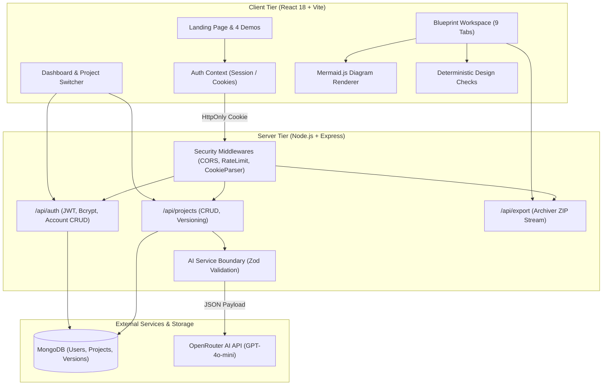
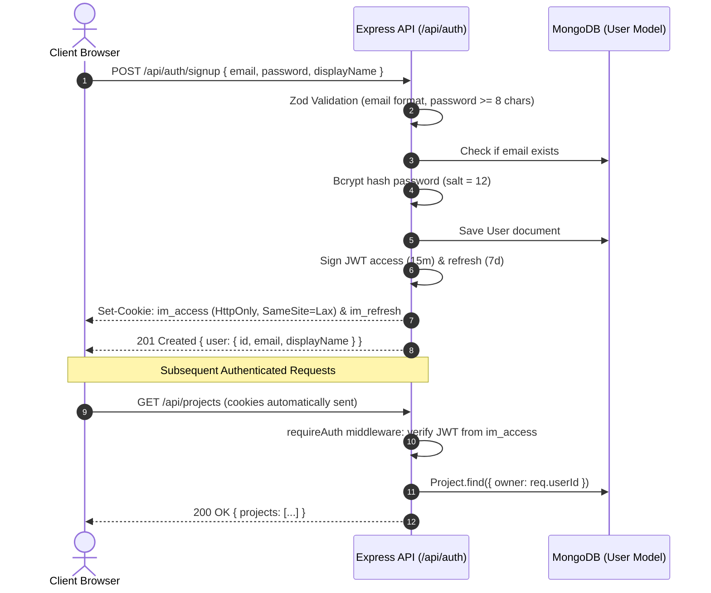

# InfraMind 2.0 — AI System Architecture & Planning Platform

InfraMind turns plain-English application requirements into developer-ready system blueprints. It bridges the gap between high-level product ideation and low-level software implementation by producing architectural topologies, MongoDB models, REST API contracts with status codes, OpenAPI 3.1 definitions, and downloadable MERN code scaffolds.

---

## Table of Contents

1. [Product Overview & Goals](#1-product-overview--goals)
2. [Feature Matrix & Implementation Status](#2-feature-matrix--implementation-status)
3. [System Architecture Diagram](#3-system-architecture-diagram)
4. [Technology Stack & Architectural Decisions](#4-technology-stack--architectural-decisions)
5. [Repository Directory Structure](#5-repository-directory-structure)
6. [Complete User Journey & Application Flow](#6-complete-user-journey--application-flow)
7. [Authentication & Authorization Flow](#7-authentication--authorization-flow)
8. [Database Models & Ownership Rules](#8-database-models--ownership-rules)
9. [OpenRouter AI Synthesis Pipeline](#9-openrouter-ai-synthesis-pipeline)
10. [Prebuilt Demo Fixtures (Zero AI Calls)](#10-prebuilt-demo-fixtures-zero-ai-calls)
11. [Environment Variables Reference](#11-environment-variables-reference)
12. [Local Installation & Startup](#12-local-installation--startup)
13. [Database Setup & Resilience](#13-database-setup--resilience)
14. [API Route Documentation](#14-api-route-documentation)
15. [Automated Testing & Quality Checks](#15-automated-testing--quality-checks)
16. [Production Build & Deployment](#16-production-build--deployment)
17. [Security & Secret Management](#17-security--secret-management)
18. [Troubleshooting & FAQs](#18-troubleshooting--faqs)
19. [Screenshots & Visual Tour](#19-screenshots--visual-tour)
20. [Roadmap & Contribution Guide](#20-roadmap--contribution-guide)

---

## 1. Product Overview & Goals

Software projects often stumble in the transition between non-technical feature ideas and initial implementation. InfraMind solves this by:

- **Empowering Founders & Beginners:** Transforms unstructured thoughts into structured requirements, visual diagrams, and explicit domain boundaries without requiring prior distributed systems expertise.
- **Accelerating Senior Engineers:** Delivers immediate Mongoose schema drafts, idempotent REST API definitions, and starter codebases with strict security rules.
- **Domain-Independent Generation:** Adapts seamlessly to SaaS, e-commerce, marketplaces, booking platforms, EdTech, healthcare, fintech, AI tools, or internal business operations. Never hardcodes a single domain.
- **Deterministic Validation:** Runs client-side heuristic checks on generated topologies to catch disconnected services, duplicate routes, or missing collection references.
- **Full Version Control:** Allows users to refine requirements and branch new blueprint versions without destroying earlier iterations.

---

## 2. Feature Matrix & Implementation Status

| Feature | Status | Description |
|---|---|---|
| **Consolidated 5 Workspaces** | Complete | Replaced 14 horizontally scrolling tabs with exactly 5 primary workspaces (Overview, Architecture, Change Impact, Validate, Build & History). |
| **Compact Single-Row Header** | Complete | Breadcrumbs, inline editable project name, verified save status badge, version dropdown, history action, and secondary menu. |
| **Structured Overview Renderer** | Complete | Semantic components (`ProjectBrief`, `RequirementList`, `ArchitectureDecisionCard`, `AssumptionList`, `RoadmapTimeline`, `ProjectHealthSummary`). Eliminates text run-ins. |
| **Causal Graph & Auto-Fit Engine** | Complete | Dynamic bounding box computation, auto-fit on load, center selected node, multi-layout switcher (L→R, T↓B, Clustered), and synchronized table fallback. |
| **3-Pane Change Impact Simulator** | Complete | Left change request context, center impact graph separating direct vs transitive cascade, right verification findings, diff preview, and approval. |
| **Canonical Project Model v2.0** | Complete | Versioned typed graph connecting requirements, actors, components, entities, APIs, workflows, and tests. |
| **Blueprint Compiler & Consistency Engine** | Complete | 6 categories of deterministic checks: Graph Integrity, Traceability, API, Data, Workflow, and Security rules. |
| **Deterministic Workflow Simulator** | Complete | Interactive state-machine simulation with active state tracking, event dispatch, guards, and scenario library. |
| **Threat Model & STRIDE Analysis** | Complete | Visual trust boundaries, STRIDE vulnerability categorization, status management, and reliability mitigations. |
| **Visual API Flow Editor** | Complete | Graph chaining of API requests, JWT propagation, assertion evaluations, and deterministic mock runner. |
| **Semantic Version Diffs & DDR** | Complete | Stable ID diffing across versions with automated Design Decision Record (DDR) generation. |
| **Repository Reality Check** | Complete | Static AST drift detection comparing Express routes and Mongoose models against canonical blueprints. |
| **Interactive Demos (4x)** | Complete | CommerceFlow, SlotWise, LearnSphere, PulseBoard bundled as static JSON fixtures (0 AI API calls). |
| **Architecture Diagram Workspace** | Complete | Mermaid.js rendering with interactive Pan/Zoom toolbar, SVG export, fullscreen toggle, and fallback list. |
| **MongoDB Schema Explorer** | Complete | Collections, typed fields, foreign keys, and one-click Mongoose Schema snippet export to clipboard. |
| **REST API Explorer & cURL** | Complete | HTTP method filters (GET/POST/PATCH/DELETE), route search, payload inspect, and copyable cURL commands. |
| **HttpOnly JWT Auth & Cloud Persistence** | Complete | Signup, signin, signout, current user (`/me`), bcrypt password hashing, and MongoDB document persistence. |
| **OpenAPI 3.1 & MERN Scaffold Export** | Complete | One-click JSON export compliant with Swagger UI/Postman and downloadable ZIP starter codebase. |

---

## 3. System Architecture Diagram



---

## 4. Technology Stack & Architectural Decisions

### Frontend
- **React 18 & Vite 6:** Ultra-fast bundling, ES module loading, and modern component lifecycle.
- **Lucide React:** Consistent developer-tool iconography.
- **Mermaid.js (v11):** Client-side SVG generation for system architecture topology diagrams.
- **Pure Vanilla CSS:** Custom tailored tokens (`DM Mono`, `Inter`), dark palette (`#0a0c12`), and zero framework bloat.

### Backend
- **Node.js (ESM) & Express 4:** Lightweight, performant REST service.
- **Mongoose 8:** Object modeling with schema-level validation, compound indexing, and population.
- **jsonwebtoken (JWT):** Stateless authentication using 15-minute access tokens and 7-day refresh tokens delivered exclusively via `HttpOnly`, `SameSite=Lax` cookies.
- **bcryptjs:** Salt rounds = 12 for irreversible password security.
- **Zod 3:** Runtime payload validation on input specifications, auth bodies, and AI completions.
- **Archiver:** High-performance zlib compression stream for downloading starter scaffolds.
- **express-rate-limit:** Multi-tiered defense (60 req/min general, 5 req/min on AI and auth).

---

## 5. Repository Directory Structure

```
inframind/
├── README.md                          # Comprehensive documentation
├── client/                            # React 18 + Vite frontend
│   ├── .env.example                   # Client environment template
│   ├── .gitignore                     # Git exclusions
│   ├── index.html                     # HTML5 entry with metadata
│   ├── package.json                   # Dependencies & test scripts
│   ├── vite.config.js                 # Vite bundler configuration
│   └── src/
│       ├── App.jsx                    # Root state router & shell
│       ├── index.css                  # Design system tokens & layouts
│       ├── main.jsx                   # React root with AuthProvider
│       ├── components/
│       │   ├── ArchitectureDiagram.jsx# Mermaid SVG renderer with fallback
│       │   ├── AuthModal.jsx          # Sign-in & registration dialog
│       │   ├── Dashboard.jsx          # Welcome hero, metrics & project list
│       │   ├── DemoViewer.jsx         # Static fixture viewer (0 AI calls)
│       │   ├── LandingPage.jsx        # SaaS marketing page with live preview
│       │   ├── MyProjects.jsx         # Searchable project list & operations
│       │   ├── NewBlueprint.jsx       # Guided specification input form
│       │   ├── ProjectWorkspace.jsx   # Active blueprint view & versioning
│       │   ├── ResultPanel.jsx        # 9-tab technical blueprint explorer
│       │   └── Settings.jsx           # Profile, password & danger zone
│       ├── context/
│       │   └── AuthContext.jsx        # React auth context & session restore
│       ├── data/
│       │   └── demoProjects/          # Static version-controlled fixtures
│       │       ├── commerceflow.js    # E-commerce marketplace fixture
│       │       ├── slotwise.js        # Appointment booking platform fixture
│       │       ├── learnsphere.js     # Learning management system fixture
│       │       ├── pulseboard.js      # Project management SaaS fixture
│       │       └── index.js           # Fixtures index & helper lookup
│       └── lib/
│           ├── api.js                 # Centralized fetch client with cookies
│           ├── blueprint.js           # Heuristic checks & OpenAPI 3.1 exporter
│           ├── blueprint.test.js      # Unit tests for checks & OpenAPI export
│           └── demos.test.js          # Automated verification for 0 AI calls
└── server/                            # Node.js + Express backend
    ├── .env                           # Server secrets (git-ignored)
    ├── .env.example                   # Safe environment template
    ├── .gitignore                     # Excludes node_modules & .env
    ├── auth.js                        # JWT signing & cookie helpers
    ├── db.js                          # Mongoose connection & graceful fallback
    ├── index.js                       # Express application server entry
    ├── openrouter.js                  # OpenRouter AI prompt & Zod schema
    ├── package.json                   # Server dependencies & test script
    ├── server.test.js                 # Backend unit & integration test suite
    ├── models/
    │   ├── Project.js                 # Project & version history schema
    │   └── User.js                    # User account schema with bcrypt
    └── routes/
        ├── auth.js                    # Signup, signin, /me, profile, password
        └── projects.js                # Project CRUD, versioning, duplication
```

---

## 6. Complete User Journey & Application Flow

1. **Discovery on Landing Page:** The user visits `http://localhost:5173`. They explore the value pillars, read the 4-step workflow, and inspect an interactive preview card.
2. **Zero-AI Demo Exploration:** Clicking "Explore Blueprint" on any of the four demo cards opens `CommerceFlow`, `SlotWise`, `LearnSphere`, or `PulseBoard` instantly. The user inspects architecture, collections, and REST contracts with zero latency and 0 AI tokens consumed.
3. **Template Copy / Workspace Launch:** From a demo, clicking "Use as starting point" copies the precomputed specification into the New Blueprint form without triggering AI.
4. **Authentication (Optional or Immediate):** The user can sign up with email and password. Sessions are established through HttpOnly cookies. If the user prefers guest mode, they can generate blueprints immediately.
5. **Specification Formulation:** In the New Blueprint view, the user inputs their application requirements (or picks a quick-start template). Character count and input constraints are clearly signaled.
6. **AI Synthesis:** The user clicks "Generate Blueprint". The UI displays an animated progress card. OpenRouter returns structured JSON validated by Zod on the server.
7. **Inspection & Validation:** The generated blueprint appears in the workspace with 9 specialized tabs:
   - *Overview:* Problem statement, target personas, feature priorities, assumptions, roadmap.
   - *Architecture:* Mermaid.js topology diagram with component list fallback.
   - *Roles & Permissions:* Domain-tailored personas and least-privilege rules.
   - *Workflows:* Step-by-step user journeys and state machine outcomes.
   - *MongoDB Collections:* Field names, types, primary/foreign keys.
   - *REST APIs:* Endpoint paths, methods, request/response bodies, status codes.
   - *Security & Reliability:* Auth model, rate limiting, and threat analysis.
   - *MERN Scaffold:* File tree and copyable source code.
   - *Design Checks:* Heuristic pass/review warnings.
8. **Branching & Version Control:** Clicking "Refine / New Version" allows the user to update the specification and generate version `v2`, keeping `v1` accessible in the version dropdown.
9. **Export Artifacts:** The user exports OpenAPI 3.1 JSON for Postman or downloads the MERN starter scaffold as a ZIP archive.

---

## 7. Authentication & Authorization Flow



### Security Safeguards
- **No Client-Side Token Storage:** Tokens are NEVER placed in `localStorage` or `sessionStorage`, mitigating Cross-Site Scripting (XSS) token theft.
- **Password Protection:** Plaintext passwords are never stored, logged, or serialized. The `User` Mongoose schema uses `select: false` on `passwordHash`.
- **Account Enumeration Defense:** Sign-in endpoints return generic error messages for nonexistent emails and invalid passwords.

---

## 8. Database Models & Ownership Rules

### User Model (`server/models/User.js`)
- `displayName`: String (max 80 chars, trimmed).
- `email`: String (lowercase, unique index, validated format).
- `passwordHash`: String (bcrypt hash, excluded from queries by default).
- `timestamps`: `createdAt`, `updatedAt`.
- Method `toSafeObject()` strips `passwordHash` before serialization.

### Project Model (`server/models/Project.js`)
- `owner`: ObjectId referencing `User` (indexed).
- `name`: String (trimmed, max 120 chars).
- `specification`: String (the prompt requirements).
- `blueprint`: Mixed (the active/latest synthesized blueprint document).
- `versions`: Array of `blueprintVersionSchema` subdocuments:
  - `versionNumber`: Number.
  - `specification`: String.
  - `blueprint`: Mixed.
  - `createdAt`: Date.
- `versionCounter`: Integer incremented on each new version.
- **Capping Policy:** Keeps the last 20 versions per project to prevent unbounded document growth.
- **Ownership Enforcement:** All operations (`GET /:id`, `PATCH /:id`, `DELETE /:id`, `POST /:id/generate`, `POST /:id/duplicate`) verify `owner: req.userId`.

---

## 9. OpenRouter AI Synthesis Pipeline

1. **Prompt Compilation:** `server/openrouter.js` constructs a domain-agnostic architectural prompt injecting the user's specification.
2. **Dual-Mode Completion:** Sends a POST request to `https://openrouter.ai/api/v1/chat/completions` with `{ response_format: { type: "json_object" } }`. If the selected provider returns HTTP 400 for JSON mode, InfraMind automatically retries once without JSON mode.
3. **JSON Extraction & Sanitization:** Cleans Markdown code blocks (` ```json ... ``` `) and extracts top-level JSON boundaries.
4. **Zod Runtime Schema Validation:** Validates the presence and types of `projectName`, `summary`, `overview`, `architecture` (nodes & edges), `database` (tables & columns), `apis` (methods, paths, status codes), and `scaffold` (files).
5. **Path Traversal Shield:** Scans all generated scaffold paths. Any path containing `..`, starting with `/`, or including null bytes (`\0`) is rejected.

---

## 10. Prebuilt Demo Fixtures (Zero AI Calls)

To allow users to explore InfraMind without requiring immediate API keys or account credits, four complete blueprints are bundled:

1. **CommerceFlow (`client/src/data/demoProjects/commerceflow.js`):** E-commerce marketplace with catalog search, inventory concurrency, Stripe webhooks, order lifecycle, and seller verification.
2. **SlotWise (`client/src/data/demoProjects/slotwise.js`):** Appointment booking platform with double-booking prevention, provider schedule rules, and calendar synchronization.
3. **LearnSphere (`client/src/data/demoProjects/learnsphere.js`):** Learning management system with video lesson progression, auto-graded quizzes, and verifiable certificates.
4. **PulseBoard (`client/src/data/demoProjects/pulseboard.js`):** Multi-tenant project management SaaS with RBAC, Kanban task states, and tenant-scoped queries.

### Proof of Zero AI Requests
The automated test suite in `client/src/lib/demos.test.js` spies on the global `fetch` object and asserts that browsing, loading, inspecting checks, and exporting contracts across all 4 demos executes **exactly 0 calls** to `/api/generate` or OpenRouter.

---

## 11. Environment Variables Reference

### Backend (`server/.env`)

| Variable | Required | Default | Purpose |
|---|---|---|---|
| `OPENROUTER_API_KEY` | Yes | — | Your OpenRouter secret key (`sk-or-v1-...`). Never exposed to client. |
| `OPENROUTER_MODEL` | No | `openai/gpt-4o-mini` | OpenRouter model ID. Can be any model available to your account. |
| `OPENROUTER_SITE_URL` | No | `http://localhost:5173` | Sent in `HTTP-Referer` header to OpenRouter. |
| `OPENROUTER_APP_NAME` | No | `InfraMind` | Sent in `X-Title` header to OpenRouter. |
| `OPENROUTER_TIMEOUT_MS`| No | `120000` | AbortSignal timeout for AI generation (milliseconds). |
| `OPENROUTER_MAX_TOKENS`| No | `12000` | Maximum token completion limit. |
| `MONGODB_URI` | Yes | `mongodb://127.0.0.1:27017/inframind` | MongoDB connection string (Local or Atlas). |
| `JWT_SECRET` | Yes | — | Random secret key (min 32 characters) for signing auth tokens. |
| `JWT_EXPIRES_IN` | No | `15m` | Access token expiration. |
| `JWT_REFRESH_EXPIRES_IN`| No| `7d` | Refresh token expiration. |
| `PORT` | No | `5000` | Express HTTP port. |
| `CLIENT_ORIGIN` | No | `http://localhost:5173` | Allowed CORS origin for credentials. |
| `NODE_ENV` | No | `development` | Set to `production` for secure cookie flags. |

### Frontend (`client/.env`)

| Variable | Required | Default | Purpose |
|---|---|---|---|
| `VITE_API_URL` | No | `http://localhost:5000` | Base URL pointing to the Express backend. |

---

## 12. Local Installation & Startup

### Step 1: Clone the repository
```bash
git clone <your-repo-url>
cd inframind
```

### Step 2: Configure & Start the Backend Server
```bash
cd server
npm install
cp .env.example .env
```

Edit `server/.env` with your preferred settings:
```dotenv
OPENROUTER_API_KEY=sk-or-v1-your-actual-key-here
MONGODB_URI=mongodb://127.0.0.1:27017/inframind
JWT_SECRET=super_secure_random_string_at_least_48_chars_long
PORT=5000
```

Start the backend:
```bash
npm run dev
```
Verify the server is running: `http://localhost:5000/api/health`

### Step 3: Configure & Start the Frontend Client
In a new terminal window:
```bash
cd client
npm install
npm run dev
```

Open `http://localhost:5173` in your browser.

---

## 13. Database Setup & Resilience

InfraMind connects to MongoDB via Mongoose:
- **Local MongoDB:** Run `mongod` or Docker:
  ```bash
  docker run -d -p 27017:27017 --name inframind-mongo mongo:7
  ```
- **MongoDB Atlas:** Set `MONGODB_URI=mongodb+srv://<username>:<password>@cluster.mongodb.net/inframind?retryWrites=true&w=majority`.
- **Offline / Disconnected Graceful Fallback:** If MongoDB is unavailable, the server remains operational. The client offers guest mode (saving drafts in local session), and the health endpoint indicates degraded status rather than crashing.

---

## 14. API Route Documentation

### Authentication (`/api/auth`)
- `POST /api/auth/signup`: Registers a new user. Hashes password with bcrypt. Sets auth cookies.
- `POST /api/auth/signin`: Verifies credentials and sets `im_access` and `im_refresh` cookies.
- `POST /api/auth/signout`: Clears auth cookies.
- `GET /api/auth/me`: Returns current authenticated user record.
- `PATCH /api/auth/profile`: Updates user display name.
- `POST /api/auth/change-password`: Changes password after verifying current password.
- `DELETE /api/auth/account`: Deletes user account and owned projects upon typing `DELETE`.

### Projects (`/api/projects`) — *Requires Authentication*
- `GET /api/projects`: Lists user-owned projects sorted by last updated.
- `POST /api/projects`: Creates a new project container with specification.
- `GET /api/projects/:id`: Retrieves project details and active blueprint.
- `PATCH /api/projects/:id`: Renames project.
- `DELETE /api/projects/:id`: Deletes project and its versions.
- `POST /api/projects/:id/duplicate`: Clones an existing project with its current blueprint.
- `POST /api/projects/:id/generate`: Calls OpenRouter, validates output, and saves a new version `v(N+1)`.
- `GET /api/projects/:id/versions/:vid`: Retrieves a specific historical version.

### Core Generation & Export
- `POST /api/generate`: Unauthenticated generation endpoint (rate limited: 5 req/min).
- `POST /api/export`: Accepts `{ files: [{ path, content }] }` and returns a streamed `.zip` archive.
- `GET /api/health`: Diagnostic health check returning service status.

---

## 15. Automated Testing & Quality Checks

### Run Frontend Tests
```bash
cd client
npm test
```
**Tests Covered:**
- Core structural checks (unique node IDs, valid edge references).
- Route validation and duplicate detection.
- OpenAPI 3.1 specification schema conversion.
- Existence and schema validity of all 4 demo fixtures.
- **Zero AI Calls Verification:** Spies on fetch to confirm that navigating demos triggers 0 AI requests.

### Run Backend Tests
```bash
cd server
npm test
```
**Tests Covered:**
- Bcrypt password hashing, verification, and mismatched password rejection.
- Sensitive field stripping (`toSafeObject()`).
- JWT token signing, claims verification, and tampered token rejection.
- Project version history branching and version cap (max 20).
- Path traversal rejection on scaffold files.
- Specification length constraints (20 - 10,000 characters).

### Run Frontend Production Build Check
```bash
cd client
npm run build
```

---

## 16. Production Build & Deployment

### Production Client Build
```bash
cd client
npm run build
```
Build output is generated in `client/dist/`. Serve these static assets using Nginx, Vercel, Cloudflare Pages, or Express static middleware.

### Production Server Checklist
1. Set `NODE_ENV=production` in `server/.env`.
2. Ensure `JWT_SECRET` is a cryptographically strong 48+ character random string.
3. Configure `CLIENT_ORIGIN` to match your production frontend URL (e.g. `https://inframind.yourdomain.com`).
4. Ensure your server is served over HTTPS so cookies can use `Secure: true`.
5. Run behind a reverse proxy (e.g., Nginx, AWS ALB) with rate limiting and DDoS protection.

---

## 17. Security & Secret Management

- **Zero Client-Side Secrets:** `OPENROUTER_API_KEY`, database credentials, and `JWT_SECRET` are strictly kept on the server.
- **Git Exclusions:** `.env` is ignored in both client and server repositories.
- **Input Sanitization:** All user inputs are validated with Zod before processing.
- **CORS Credentials:** Restricted exclusively to the configured `CLIENT_ORIGIN` with credentials enabled.
- **Scaffold Zip Traversal Defense:** Every file path in exported scaffolds is verified against directory traversal (`..`), absolute root paths (`/`), and null bytes (`\0`).

---

## 18. Troubleshooting & FAQs

### Q: Why do I get "Unable to generate the architecture" on generation?
- Check your `server/.env` to ensure `OPENROUTER_API_KEY` is present and starts with `sk-or-v1-`.
- Verify your OpenRouter account balance/credits at [openrouter.ai/credits](https://openrouter.ai/credits).
- Verify the selected `OPENROUTER_MODEL` is active and supported.

### Q: Can I use InfraMind without an OpenRouter API key?
- Yes! The four interactive demos (`CommerceFlow`, `SlotWise`, `LearnSphere`, `PulseBoard`) run completely offline from precomputed static JSON fixtures without requiring any API key.

### Q: Why does the architecture diagram show a structured list instead of SVG?
- If Mermaid.js encounters complex label characters or rendering issues in certain browser configurations, InfraMind automatically falls back to an accessible, structured component flow rather than displaying a blank canvas.

---

## 19. Screenshots & Visual Tour

*(To add genuine screenshots, run the local app, capture screenshots of the landing page, dashboard, and blueprint workspace, and save them to `docs/screenshots/`)*

1. **SaaS Landing Page:** Hero section, trust pillars, and live interactive blueprint preview card.
2. **Dashboard Overview:** Recent saved projects, system metrics, and quick demo links.
3. **Architecture Workspace:** Multi-tier Mermaid topology diagram with component list and relationship legend.
4. **Data Models & Contracts:** MongoDB collections, schema relationships, and REST endpoint payload inspectors.
5. **Code Scaffold:** Downloadable MERN starter files and OpenAPI 3.1 specification.

---

## 20. Roadmap & Contribution Guide

- [x] InfraMind 2.0 Core Upgrade (Landing page, 4 prebuilt demos, JWT auth, Mongoose persistence).
- [x] Branching version history up to 20 versions.
- [x] Deterministic design checks and OpenAPI 3.1 exporter.
- [ ] Direct GitHub repository export integration.
- [ ] Multi-stack scaffold options (Next.js + Prisma, Go + PostgreSQL).
- [ ] Real-time team collaboration on blueprint canvases.

### Contributing
1. Fork the repository.
2. Create your feature branch (`git checkout -b feature/amazing-feature`).
3. Commit your changes (`git commit -m 'feat: add amazing feature'`).
4. Ensure all client and server tests pass (`npm test` in both directories).
5. Push to the branch (`git push origin feature/amazing-feature`).
6. Open a Pull Request.
